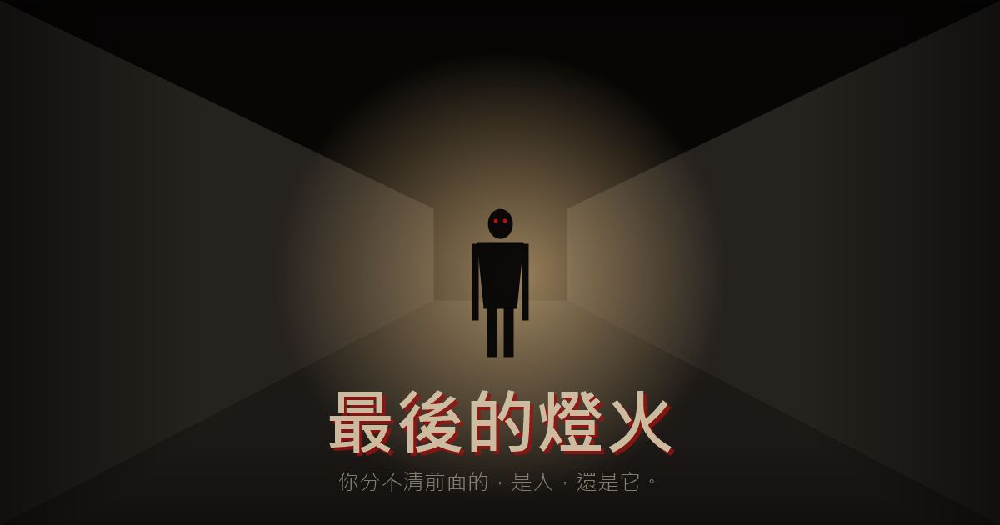

# 最後的燈火 · LAST LIGHT



第一人稱末日恐怖生存網頁遊戲。

病毒「靜默症」爆發，感染者會**模仿人類**——聲音、求救，甚至記憶。
你必須在黑暗中摸索、建立庇護所、拯救倖存者，但你永遠分不清前面的，是人，還是它。

**每次只有兩個選擇。選錯，就會死。**

## 遊玩

- 線上遊玩：開啟本專案的 GitHub Pages 網址
- 本機遊玩：下載後直接雙擊 `index.html`

建議戴上耳機、關燈遊玩。本遊戲含突然的驚嚇畫面與聲音。

## 操作

| 操作 | 說明 |
|---|---|
| 移動滑鼠／手指 | 操控手電筒，光停留久一點會發現線索 |
| 點擊選項／按 `1` `2` | 做出選擇 |
| 點擊畫面／空白鍵 | 跳過文字動畫 |

## 目前進度

- [x] 第一章〈第一夜〉
- [x] 第二章〈微光〉
- [x] 庇護所夜晚系統（食物／電力／藥品、派人搜刮）
- [ ] 第三章〈擴張〉
- [ ] 第四章〈牆內〉
- [ ] 第五章〈信號〉與三種結局

## 技術

- 純 HTML／CSS／JavaScript，不需要安裝、不需要伺服器
- 畫面全部由 Canvas 即時繪製，音效由 Web Audio API 即時合成，沒有外部圖片或音檔
- 進度存在瀏覽器的 localStorage，不會上傳任何資料

```
index.html      入口
css/style.css   介面與恐怖特效
js/audio.js     合成音效
js/render.js    第一人稱畫面、手電筒、驚嚇畫面
js/story.js     劇情資料
js/shelter.js   庇護所系統
js/engine.js    遊戲流程
assets/         圖示與分享縮圖
```
